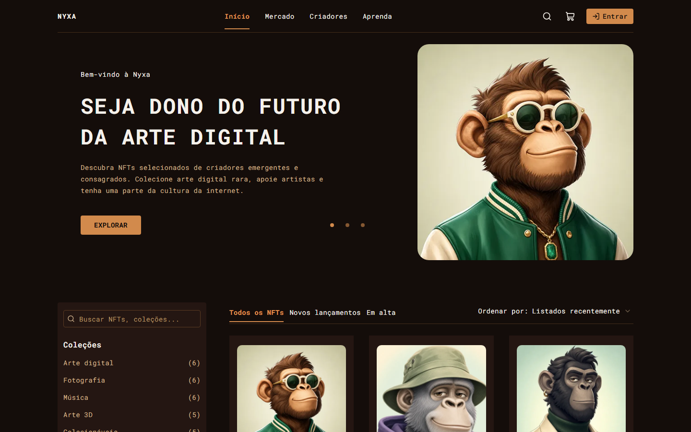

# Nyxa

**Marketplace de NFTs** · React · TypeScript · TanStack Router e Query · Socket.IO · MSW

[](https://nyxa-nft-marketplace.vercel.app)
[](#testes-e-qualidade)
[](https://react.dev)
[](https://www.typescriptlang.org)
[](https://vite.dev)
[](https://tailwindcss.com)
[](https://playwright.dev)
[](LICENSE)

Marketplace de arte digital com catálogo, favoritos, carrinho, checkout e conta do colecionador. Preços e estoque mudam em tempo real pelo Socket.IO, e a compra continua correta mesmo com rede lenta, resposta perdida ou clique repetido.

🔗 **Demo:** [nyxa-nft-marketplace.vercel.app](https://nyxa-nft-marketplace.vercel.app)



> Projeto pessoal de portfólio. "Nyxa" é uma marca fictícia. Não há backend real: a API REST e os eventos em tempo real são simulados no navegador com MSW, inclusive na demo publicada.

## Funcionalidades

- Catálogo com busca, filtros (categoria, rede, preço, disponibilidade) e ordenação salvos na URL
- Página do NFT com galeria, edições, avaliações e preço atualizado em tempo real
- Cadastro, login, logout e sessão que expira, com volta para a página onde a pessoa estava
- Favoritos com resposta imediata e desfeitos sozinhos se a API falhar
- Carrinho com cupom, persistido entre visitas e unido ao da conta no login
- Checkout com revisão dos valores, pedido idempotente (um clique repetido ou um reenvio não cria dois pedidos) e aviso quando preço ou estoque mudam
- Perfil com atividade, pedidos e carteiras
- Reconexão do tempo real com reconciliação pela API, sem aplicar eventos duplicados ou antigos
- Painel "Cenários" para simular falhas: lentidão, erro do servidor, sessão expirada, pagamento recusado e outras

## Stack

- **[React 19](https://react.dev)** + **TypeScript** + **[Vite](https://vite.dev)**
- **[TanStack Router](https://tanstack.com/router)** para rotas e **[TanStack Query](https://tanstack.com/query)** para cache dos dados
- **Axios** e **socket.io-client**
- **[MSW](https://mswjs.io)** para simular a API REST e o Socket.IO
- **[Tailwind CSS v4](https://tailwindcss.com)** + **shadcn/ui**
- **zod** para validar os contratos e **decimal.js** para os valores em ETH
- **[Playwright](https://playwright.dev)** para os testes E2E e **Lighthouse** para a auditoria
- **[Vercel](https://vercel.com)** para o deploy

A arquitetura, os contratos REST e de eventos, o cache e a reconciliação estão em [ARCHITECTURE.md](./ARCHITECTURE.md).

## Como rodar localmente

Requisitos: Node.js 20 ou mais recente e npm.

```bash
git clone https://github.com/joaobatis1a/nyxa.git
cd nyxa
npm ci
npm run dev
```

Abra [http://localhost:5173](http://localhost:5173). Os mocks já vêm ligados.

### Variáveis de ambiente

Todas são opcionais.

| Variável | Padrão | Uso |
| --- | --- | --- |
| `VITE_ENABLE_MOCKS` | ligado | `false` desliga o MSW |
| `VITE_MOCK_SCENARIO` | `default` | Cenário inicial da API simulada |
| `PW_CHROMIUM_PATH` | não definido | Caminho de um Chromium já instalado, para o Playwright |
| `E2E_BASE_URL` | preview local | Roda os testes contra outra URL (ex.: a demo) |
| `CHROME_PATH` | Chromium do Playwright | Navegador usado pelo Lighthouse |
| `LH_BASE_URL` / `LH_RUNS` | preview local / 3 | URL auditada / número de medições |

### Comandos

| Comando | O que faz |
| --- | --- |
| `npm run dev` | Desenvolvimento com mocks |
| `npm run build` | Verificação de tipos e build de produção (`dist/`) |
| `npm run preview` | Serve o build em http://localhost:4173 |
| `npm run typecheck` | Verificação de tipos |
| `npm run lint` | ESLint |
| `npm run test:e2e` | Testes Playwright, desktop e mobile (faz o build e sobe o preview sozinho) |
| `npm run test:e2e:update` | Gera de novo as imagens da regressão visual |
| `npm run test:e2e:report` | Relatório HTML, com traces das falhas |
| `npm run lighthouse` | Auditoria Lighthouse (3 medições por página e perfil) |

Para os testes e o Lighthouse, instale o navegador uma vez com `npx playwright install chromium`.

## Contas e cupons de teste

| Usuário | E-mail | Senha |
| --- | --- | --- |
| Ana | `ana@example.com` | `Senha@123` |
| Bruno | `bruno@example.com` | `Senha@456` |

Cupons: `WELCOME10` (10%), `ETHER5` (5%) e `EXPIRED20` (expirado). Qualquer outro código é inválido.

## Cenários da API simulada

Formas de escolher o cenário:

1. **Painel "Cenários"**, no canto inferior esquerdo (também na demo): escolha e clique em **Aplicar**.
2. **URL:** `?scenario=<id>`, ex.: https://nyxa-nft-marketplace.vercel.app/?scenario=slow (fica salvo na aba).
3. **Build:** variável `VITE_MOCK_SCENARIO`.
4. **Console:** `window.__mock.setScenario('<id>')`.

Para voltar ao estado inicial, use o botão **Restaurar dados** no painel ou `await window.__mock.reset()`. Os dois restauram o banco simulado, a sessão e o carrinho.

| Cenário | Efeito |
| --- | --- |
| `default` | Tudo funciona, latência baixa |
| `empty` | Catálogo vazio |
| `slow` | Respostas de cerca de 2 s |
| `variable-latency` | Latência entre 50 ms e 1,8 s, sempre na mesma sequência |
| `out-of-order` | Buscas mais longas respondem antes |
| `offline` | Queda de conexão em toda requisição `/api` |
| `server-error` | Toda requisição `/api` responde 500 |
| `unavailable` | Toda requisição `/api` responde 503 |
| `expired-session` | Rotas autenticadas respondem 401 `session_expired` |
| `price-changed` | O preço do 1º item sobe entre a revisão e a confirmação |
| `sold-out` | A edição do 1º item esgota entre a revisão e a confirmação |
| `order-timeout` | O pedido é criado, mas a 1ª resposta nunca chega |
| `payment-rejected` | Pagamento recusado |
| `slow-payment` | Pedido fica pendente por 6 s |
| `favorite-fails` | Favoritar e desfavoritar respondem 503 |
| `wallet-refused` | A carteira recusa a conexão |

### Como reproduzir as falhas

Entre como Ana, adicione um NFT ao carrinho e siga:

| Fluxo | Passos | Resultado esperado |
| --- | --- | --- |
| Pagamento recusado | Cenário `payment-rejected`, Pagamento, conectar carteira, Confirmar compra, Confirmar e pagar | "Pagamento recusado" e os itens continuam no carrinho |
| Timeout com idempotência | Cenário `order-timeout` e confirmar a compra | Depois de uns 8 s o app reenvia com a mesma chave e abre o mesmo pedido. Só aparece 1 pedido em Perfil, Atividade |
| Clique repetido | Clicar várias vezes em "Confirmar e pagar" | Um único pedido |
| Preço alterado | Cenário `price-changed` e confirmar | Aviso "Os valores mudaram" com o novo total. É preciso confirmar de novo |
| Esgotado | Cenário `sold-out` e confirmar | Aviso de indisponibilidade e o pedido não é criado |
| Tempo real | Com o carrinho aberto, no console: `__mock.updateEdition('nft-01','nft-01-std',{priceEth:'2'})` | Aviso e resumo recalculado pela API |
| Queda do socket com pedido pendente | Cenário `slow-payment`, confirmar, `__mock.socket.disconnect()` e recarregar | O mesmo pedido pendente e depois o recibo, sem nova compra |
| Eventos duplicados ou antigos | No detalhe de um NFT: `__mock.socket.replayLast()` e `__mock.socket.emitStale('nft-03')` | Nada muda na tela |
| Sessão expirada | No pagamento: `__mock.expireSession()` e confirmar (ou cenário `expired-session`) | Vai para o login com aviso e, depois de entrar, volta ao pagamento com os campos preenchidos |
| Carteira recusada | Cenário `wallet-refused` e Conectar carteira | Mensagem de recusa e dá para tentar de novo |
| Falha ao favoritar | Cenário `favorite-fails` e favoritar | O favorito volta ao estado anterior, com aviso |
| API fora do ar | Cenário `offline` ou `server-error` e abrir o início | Erro com "Tentar novamente". Voltar ao `default` e tentar de novo recupera |
| Carregamento lento | Cenário `slow` | Skeletons no catálogo, no detalhe e no resumo do carrinho |
| Respostas fora de ordem | Cenário `out-of-order` e digitar uma busca rápido | A tela mostra o resultado da última busca |

## Testes e qualidade

- **41 testes E2E** com Playwright, em desktop (1440×900) e mobile (Pixel 7): catálogo, autenticação, carrinho, compra, tempo real, conta, acessibilidade, regressão visual e contratos da API simulada.
- **Lighthouse** com mediana de 3 medições: Acessibilidade, Boas práticas e SEO em 100 nas páginas auditadas. O resultado completo está em [lighthouse/summary.md](./lighthouse/summary.md) e a análise em [ARCHITECTURE.md](./ARCHITECTURE.md#performance-e-lighthouse).

## Uso de IA

Usei IA (Claude) como apoio no desenvolvimento. Ela me ajudou principalmente com a estrutura de pastas, o código das telas e dos mocks, os testes Playwright e a documentação.

A minha parte foi definir os requisitos, revisar o código, rodar e depurar os testes e entender as decisões de arquitetura: a estratégia de cache, a idempotência dos pedidos, o tempo real com reconciliação e a camada de mocks.

## Autor

**João Batista Neto**

- GitHub: [@joaobatis1a](https://github.com/joaobatis1a)
- LinkedIn: [joao-batista-silva-neto](https://linkedin.com/in/joao-batista-silva-neto)
- E-mail: [profissionalba1is1a@gmail.com](mailto:profissionalba1is1a@gmail.com)

## Licença

Distribuído sob a licença MIT. Veja [`LICENSE`](LICENSE) para mais detalhes.
